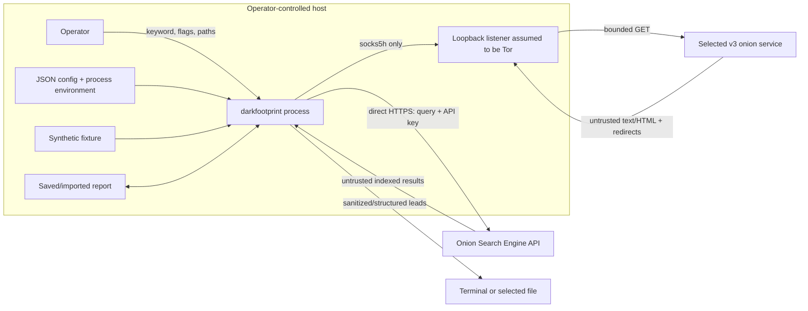

# Threat model

This is a repository-wide threat model for `darkfootprint` 0.1. It describes
security boundaries and plausible attacker stories; it is not a vulnerability
report and does not claim that a listed hypothesis is exploitable.

## 1. Overview

`darkfootprint` is a local TypeScript CLI for defensive OSINT. An operator gives
it a keyword, selects an authorized index, and receives normalized references to
v3 onion services. Indexed search and direct onion access are deliberately
separate. Search uses either a no-network synthetic fixture or one fixed
third-party HTTPS API. Onion verification occurs only after explicit flags and
a risk acknowledgement, through a local `socks5h` listener.

There is no remote user interface, daemon, browser, bundled Tor process,
database, telemetry, or background persistence. Normal search/report execution
is a single local process that writes to stdout unless the operator selects an
output path. `init` is the explicit exception: it creates a non-secret JSON
configuration unless run with `--dry-run` (`src/cli.ts:249-287`).

### Components and evidence

| Component                    | Security-relevant role                                                                                                    | Evidence                                                                                     |
| ---------------------------- | ------------------------------------------------------------------------------------------------------------------------- | -------------------------------------------------------------------------------------------- |
| CLI                          | Defines the local entry points, risk-acknowledgement gates, file choices, and exit behavior.                              | `src/cli.ts:153-591`                                                                         |
| Configuration                | Loads strict non-secret settings, an environment-only API key, limits, and a loopback-only `socks5h` proxy.               | `src/config.ts:7-30`, `src/config.ts:56-66`, `src/config.ts:68-138`, `src/config.ts:150-200` |
| Source registry              | Makes the fixture and Onion Search Engine API automatable; Ahmia is descriptor-only and manual.                           | `src/providers/registry.ts:6-30`                                                             |
| Search pipeline              | Normalizes queries, constrains work, invokes sources, rejects invalid onion URLs, deduplicates, and ranks results.        | `src/search.ts:40-62`, `src/search.ts:80-129`, `src/search.ts:131-374`                       |
| API adapter and transport    | Maps a runtime-validated response from one fixed direct HTTPS origin.                                                     | `src/providers/onion-search-engine.ts:12-136`, `src/http.ts:18-142`                          |
| Offline fixture              | Generates deterministic, synthetic results and no network requests.                                                       | `src/providers/fixture.ts:17-46`, `src/onion.ts:66-73`                                       |
| Onion URL validation         | Checks the v3 version/checksum and constrains scheme, credentials, and ports.                                             | `src/onion.ts:43-64`, `src/onion.ts:82-115`                                                  |
| Onion transport and verifier | Revalidates destinations and redirects, uses a SOCKS agent, bounds concurrency/content, and extracts inert text metadata. | `src/http.ts:178-323`, `src/verify.ts:22-187`                                                |
| Report boundary              | Caps and strictly validates imported records and verifies canonical URL/service/result-ID consistency before reuse.       | `src/report.ts:9-253`                                                                        |
| Rendering                    | Produces human, JSON, JSONL, or escaped Markdown output and recursively cleans provider-shaped JSON strings.              | `src/output.ts:27-108`, `src/sanitize.ts:1-103`                                              |

### Trust zones and data flow

The API and onion paths are independent. The configured Tor proxy does not
route indexed API searches. Reports classify index access as `offline`,
`direct`, or `mixed` according to the selected providers (`src/search.ts`).

### Effective resources and capabilities

| Deployment or workflow     | Resource or capability                                                               | Configuration and precedence                                                              | Safe effective value or location                                                          | Readers, writers, or recipients                                                                       | Enforcing control                                                                                                                                                           | Evidence or unknowns                                                                                                                                                                                       |
| -------------------------- | ------------------------------------------------------------------------------------ | ----------------------------------------------------------------------------------------- | ----------------------------------------------------------------------------------------- | ----------------------------------------------------------------------------------------------------- | --------------------------------------------------------------------------------------------------------------------------------------------------------------------------- | ---------------------------------------------------------------------------------------------------------------------------------------------------------------------------------------------------------- |
| Offline demonstration/test | Keyword and synthetic results                                                        | Explicit `--source fixture`                                                               | Process memory and stdout, or an operator-selected file                                   | Local process and operator only                                                                       | Fixture performs no I/O and constructs synthetic v3 hosts                                                                                                                   | `src/providers/fixture.ts:17-46`                                                                                                                                                                           |
| Live indexed search        | API credential and query                                                             | Credential: `DARKFOOTPRINT_ONIONSEARCHENGINE_API_KEY` only; query and bounds: CLI/config  | Secret remains a process-environment value; request destination is fixed HTTPS API origin | Local process and third-party provider receive the key; provider also receives query/timing/source IP | HTTPS, fixed origin, `GET`, redirects disabled, timeout, identity encoding, exact-secret redaction, 2 MiB body limit per page                                               | `src/config.ts:128-137`, `src/providers/onion-search-engine.ts:66-136`, `src/http.ts:48-142`; provider operation and current terms remain external dependencies                                            |
| Raw provider request       | Provider-shaped, unnormalized upstream JSON                                          | `request get`, source fixed to `onionsearchengine`, page 1–5                              | Stdout unless captured by caller                                                          | Local process, provider, terminal/log consumer                                                        | Same fixed API transport and normalized query; 1–60 second timeout; recursive terminal/bidi control stripping and exact-key redaction                                       | `src/cli.ts:510-572`, `src/sanitize.ts:82-103`; output is not a normalized search report                                                                                                                   |
| Local configuration        | Limits, provider default-selection flag, Tor proxy URL                               | `--config` → `DARKFOOTPRINT_CONFIG` → user-home default                                   | `.darkfootprint/config.json` below the user home by default; no credential field          | Local user/process                                                                                    | Strict Zod schema; exclusive create unless `--force`; explicit `init --force` can replace an invalid file                                                                   | `src/config.ts:7-30`, `src/config.ts:68-138`, `src/cli.ts:249-287`; file permissions are delegated to the OS                                                                                               |
| Search/report output       | Query, timestamps, result URLs, snippets, provenance, optional verification evidence | Stdout by default; `--out` chooses a path; `--force` permits replacement                  | Operator-selected destination                                                             | Operator, terminal/logging stack, filesystem readers, backups                                         | Network-produced text sanitation; Markdown escaping; redacted human diagnostics; exclusive file create by default                                                           | `src/cli.ts:55-60`, `src/cli.ts:118-140`, `src/output.ts:27-108`, `src/report.ts:255-285`; retention and filesystem ACLs are operator responsibilities                                                     |
| Imported report            | Previously saved investigation data and target set                                   | Explicit `--input` path                                                                   | Operator-selected regular JSON file no larger than 5 MiB                                  | Local process; rendered output and verifier may consume it                                            | Strict bounded arrays and known text; canonical URL, service ID, result ID, and final verification URL consistency; target revalidation                                     | `src/cli.ts:403-509`, `src/report.ts:9-253`; validation cannot establish truth or provenance authenticity                                                                                                  |
| Onion verification         | Ability to contact selected onion services                                           | Command `--proxy` → `DARKFOOTPRINT_TOR_PROXY` → JSON setting → `socks5h://127.0.0.1:9050` | Credential-free `socks5h` URL on `127.0.0.1`, `localhost`, or `::1`                       | Local process, local proxy, Tor network, selected onion service                                       | CLI risk acknowledgement; loopback/scheme validation; TCP probe; checksum-valid v3 URL; ports 80/443; same-host redirects; text-only body; max 20 results, two concurrently | `src/config.ts:56-66`, `src/config.ts:78-104`, `src/config.ts:150-200`, `src/cli.ts:337-438`, `src/verify.ts:124-170`, `src/http.ts:254-323`; a successful probe does not authenticate the listener as Tor |

## 2. Threat Model, Trust Boundaries, and Assumptions

### Protected assets

- **Provider credential:** the Onion Search Engine API key in the process
  environment.
- **Investigation privacy:** keywords, timing, selected sources, onion targets,
  result snippets, and the fact that an investigation occurred.
- **Routing guarantee:** onion destinations must not be resolved or contacted by
  the application's direct network path.
- **Host integrity:** hostile provider or onion data must remain inert and must
  not cause code execution, browser behavior, unintended file writes, or
  requests outside the selected boundary.
- **Report integrity and semantics:** provenance, canonical identifiers,
  verification state, and warnings must not imply authenticity or attribution.
- **Resource availability:** provider/onion responses and operator-controlled
  options must remain within explicit page, result, timeout, redirect, body, and
  concurrency bounds.
- **Source-policy integrity:** sources marked manual-only must not silently become
  automated.

### Actors and starting capabilities

| Actor                             | Initially controls                                                                                       | Does not initially control                                                                                       |
| --------------------------------- | -------------------------------------------------------------------------------------------------------- | ---------------------------------------------------------------------------------------------------------------- |
| Authorized operator               | CLI arguments, keyword, environment, config/input/output paths, whether to acknowledge verification risk | Third-party API data, onion content, network infrastructure                                                      |
| API provider                      | Indexed response body and metadata; legitimately receives the query, API key, timing, and source IP      | Local flags, files, Tor settings, and verification opt-in                                                        |
| On-path network attacker          | Observable destination, timing, and traffic volume on direct API traffic                                 | HTTPS plaintext, API key, query, or response integrity under the platform-TLS assumption                         |
| Indexed-content author            | Text and onion URL that the provider may index                                                           | Whether the provider returns it, operator opt-in, URL validation, local proxy, and filesystem                    |
| Onion-service operator            | Response status, permitted text/HTML body, and redirect headers after the operator opts in               | Direct access to the host, cross-onion redirect permission, browser execution, and output path                   |
| Report supplier                   | Bytes in a JSON file the operator chooses to import                                                      | A valid canonical/result-ID relationship unless constructed consistently; verification proxy and acknowledgement |
| Local unprivileged process/user   | Potential ability to occupy or observe a loopback listener subject to OS controls                        | The operator's environment/files by assumption; same-account control already has comparable authority            |
| Dependency or CI/release attacker | A compromised package/action can execute with install/build workflow authority                           | Registry/action integrity and maintainer account controls under normal assumptions                               |

There is no remotely reachable application endpoint. A remote party gains an
input channel only through the selected provider, a selected onion response, or
an imported report supplied to the operator.

### Trust boundaries and invariants

1. **Operator → CLI.** Queries containing terminal/bidirectional controls are
   rejected and all queries are size-bounded (`src/search.ts:40-62`). Numeric
   work limits are bounded before providers run (`src/search.ts:135-168`). A file
   path or `--force` operation is treated as explicit local-user authority, not
   remote authorization.
2. **CLI → API provider.** Only the compiled-in HTTPS origin may receive the API
   key. The transport uses `GET`, rejects redirects, exposes only selected
   response headers, redacts the exact key from provider error text, and bounds
   the response (`src/http.ts:48-142`). The provider
   necessarily learns the query and credential; the CLI warns about this
   (`src/search.ts:198-215`).
3. **Provider → search/report.** The adapter validates the envelope, sanitizes
   untrusted text, and every candidate URL must pass v3 validation before it can
   become a result (`src/providers/onion-search-engine.ts:12-31`,
   `src/providers/onion-search-engine.ts:66-136`, `src/search.ts:80-107`). A match
   remains an unverified lead.
4. **Report file → CLI.** Imported structures and canonical identifiers are
   validated before showing, exporting, or verifying them
   (`src/report.ts:9-253`). The input must be a regular file no larger than 5 MiB;
   schemas are strict, main arrays are capped, and rendered strings are
   canonical and bounded. This is structural integrity, not a signature or
   proof that provenance is genuine.
5. **CLI → local proxy.** Verification requires an explicit acknowledgement and
   a credential-free loopback `socks5h` URL. There is no application fallback to
   direct transport (`src/cli.ts:337-438`, `src/config.ts:150-200`). A TCP probe
   checks reachability but not process identity (`src/verify.ts:124-153`).
6. **Proxy/Tor → onion service.** Targets and redirects must remain valid v3
   onion URLs on allowed ports and the original onion host. Only bounded
   text/HTML `GET` responses are accepted (`src/onion.ts:82-115`,
   `src/http.ts:178-323`).
7. **Untrusted text → terminal/file.** Provider and onion text is normalized,
   terminal/bidi controls are removed, and Markdown fields are escaped or placed
   in code spans (`src/sanitize.ts:1-81`, `src/output.ts:52-82`). Raw provider
   JSON is recursively stripped of controls and exact-key occurrences
   (`src/sanitize.ts:82-103`). Structured JSON remains data that downstream tools
   must validate.

### Security objectives

- Never contact an onion result during ordinary indexed search.
- Never resolve/contact an onion destination through direct networking when Tor
  is missing or misconfigured; fail closed.
- Never allow a provider result or redirect to widen the destination beyond a
  validated v3 onion service and the supported ports.
- Keep the API key out of JSON configuration, reports, diagnostics, and errors;
  send it only to the fixed provider origin.
- Keep untrusted network/report text inert across human and Markdown output.
- Enforce documented bounds before and during network operations.
- Preserve provenance and use precise states: indexed, reachable, and keyword
  present must remain distinct from authenticity, compromise, and attribution.
- Keep Ahmia manual-only unless permission and a reviewed design explicitly
  change the policy.

### Assumptions, exclusions, and open questions

- The operator is authorized, chooses minimally sensitive queries, protects
  environment variables/reports, and does not execute or browse unknown content
  obtained outside this CLI.
- Node's TLS implementation and trust store correctly authenticate the provider.
  The provider itself is trusted only to operate its account/API; its results
  are untrusted intelligence.
- The `socks5h` behavior of `socks-proxy-agent` and the local Tor process provides
  proxy-side onion resolution. The CLI validates the scheme and loopback address
  but does not authenticate the listener as Tor or inspect its configuration.
- Loopback isolation, process-environment privacy, file permissions, terminal
  logging, backups, and malware protection are delegated to the host OS. An
  attacker already controlling the operator's account or process is outside the
  meaningful privilege boundary.
- Response-size and timeout limits apply per provider page or onion request/hop,
  not as a single aggregate run budget. Search can request up to five pages;
  onion verification can follow two redirects and process up to 20 results.
- `providers.onionsearchengine.enabled` controls only implicit source selection:
  when false, a search without `--source` fails, but an explicit
  `--source onionsearchengine` still runs. `sources check` and `request get` do
  not use it as a deny control (`src/config.ts:56-59`, `src/search.ts:170-196`,
  `src/cli.ts:307-335`, `src/cli.ts:507-568`). `doctor` and `sources check`
  report key presence rather than authenticating against the provider.
- Imported reports must be regular files no larger than 5 MiB. Strict schemas
  cap the main arrays, reject unknown fields, and validate rendered strings, but
  reports have no signature. A party capable of building a consistent report
  can forge provenance; the operator must establish chain of custody
  (`src/report.ts:9-253`).
- The npm package contains compiled `dist/src`, README, and LICENSE only.
  SECURITY, threat-model, architecture, and contribution guidance are repository
  documentation and are not included in the published tarball
  (`package.json:17-21`).
- Current provider availability, API contract, data-handling terms, and Ahmia
  terms are external and may change. Source descriptors are not legal advice.
- CI performs offline tests, type checking, formatting, package inspection, and
  CodeQL. GitHub action version tags and the package registry remain supply-chain
  dependencies; no artifact signing or provenance guarantee is implemented in
  this repository configuration.
- Out of scope: truth of third-party content, completeness of any index, legal
  classification of content, attacks requiring intentional execution of
  downloaded material, and effects caused solely by an authorized operator
  choosing `--force` or an arbitrary local path.

## 3. Attack Surface, Mitigations, and Attacker Stories

Every row below is a **hypothesis**, not a confirmed finding.

| Priority | Scenario and capability gain                                                                                                                                                                                                               | Prerequisites                                                                                                   | Impact                                                                             | Existing controls                                                                                                                                                                                                           | Mitigation                                                                                                                                                        | Evidence                                                                                                                                          |
| -------- | ------------------------------------------------------------------------------------------------------------------------------------------------------------------------------------------------------------------------------------------ | --------------------------------------------------------------------------------------------------------------- | ---------------------------------------------------------------------------------- | --------------------------------------------------------------------------------------------------------------------------------------------------------------------------------------------------------------------------- | ----------------------------------------------------------------------------------------------------------------------------------------------------------------- | ------------------------------------------------------------------------------------------------------------------------------------------------- |
| P1       | A hostile indexed entry attempts to turn opt-in verification into direct DNS/HTTP, internal-network access, or a connection to a different onion service. A routing failure would give remote data control over an unintended destination. | Provider returns an attacker-controlled URL; operator explicitly enables verification; a relevant control fails | Target privacy loss, unintended network access, or contact with unreviewed content | Risk acknowledgement; checksum-valid v3 URL; HTTP(S) and ports 80/443 only; no URL credentials; loopback `socks5h`; no direct fallback; every redirect revalidated and confined to the original onion host                  | Maintain adversarial URL, redirect, and fake-SOCKS tests; keep provider and onion transports separate; treat any relaxation as security-sensitive                 | `src/cli.ts:337-438`, `src/config.ts:150-200`, `src/onion.ts:43-64`, `src/onion.ts:82-115`, `src/http.ts:254-323`                                 |
| P1       | A malicious or mistaken local listener occupies the configured loopback port and receives verification traffic because reachability is mistaken for Tor identity.                                                                          | Operator enables verification; a non-Tor process is listening at the configured address                         | Disclosure of selected onion targets and traffic to that listener                  | Proxy must be loopback `socks5h`; TCP probe; no application fallback                                                                                                                                                        | Run a trusted Tor instance under controlled OS permissions and verify listener ownership outside the CLI                                                          | `src/config.ts:150-200`, `src/verify.ts:124-153`; listener identity is not established                                                            |
| P1       | The API credential reaches an unintended origin, diagnostic, or log after an origin or redaction control fails. The provider's receipt of the key and query is expected, authorized transfer rather than leakage.                          | Live API use and a failure in origin confinement, error handling, or output redaction                           | Provider-account abuse and possible follow-on investigation exposure               | Environment-only key; fixed HTTPS origin; redirects disabled; response-header allowlist; exact-key and secret-pattern redaction                                                                                             | Use scoped, rotatable keys and protected environments; run secret scanning; retain tests for origin rejection and redaction                                       | `src/config.ts:128-137`, `src/http.ts:48-142`, `src/sanitize.ts:26-58`, `src/errors.ts:26-52`, `src/cli.ts:55-60`                                 |
| P2       | Hostile onion HTML/text attempts parser exploitation, active-content execution, terminal injection, or harmful-content persistence.                                                                                                        | Operator acknowledges risk and verifies a returned service; attacker controls the response                      | Local compromise, analyst deception, or sensitive harmful content in a report      | No browser or subresource loading; `GET` only; narrow content types; identity encoding; 512 KiB per response; selected active elements removed before text extraction; text/control sanitation; bounded evidence and hashes | Keep parsers updated; retain offline hostile-input tests; inspect reports as data in an isolated environment; consider hashes-only evidence where policy requires | `src/http.ts:178-323`, `src/verify.ts:22-121`, `src/sanitize.ts:1-73`                                                                             |
| P2       | A forged imported report supplies fabricated provenance and a consistently formed onion target.                                                                                                                                            | Operator chooses to import a report from an untrusted party and then explicitly acknowledges verification risk  | Analyst deception or chosen onion contact; no authenticity guarantee               | Regular-file and 5 MiB cap; strict schemas and array limits; canonical/bounded text; URL, service-ID, result-ID, and final-URL consistency; target revalidation; acknowledgement remains required                           | Establish chain of custody or add authenticated report signatures for cross-party exchange; keep schema, parser, and renderer fuzz tests                          | `src/report.ts:9-253`, `src/cli.ts:403-509`, `src/output.ts:27-108`                                                                               |
| P2       | A provider poisons, stales, duplicates, or mislabels indexed data so an analyst infers compromise or actor attribution.                                                                                                                    | Live indexed search and analyst reliance on one source                                                          | Incorrect escalation, reputational harm, and wasted response effort                | Runtime envelope validation; per-hit URL validation and text sanitation; provenance; deterministic merge/rank; warnings; narrowly defined verification states                                                               | Require independent corroboration and documented analytic confidence; never use relevance or reachability as a risk score                                         | `src/providers/onion-search-engine.ts:12-133`, `src/search.ts:80-129`, `src/search.ts:200-215`, `src/output.ts:16-25`, `src/output.ts:52-82`      |
| P2       | Large or slow provider/onion responses consume memory, connections, or wall time across pages, redirects, or results.                                                                                                                      | An authorized network operation reaches a slow or hostile endpoint                                              | Local denial of service and delayed investigation                                  | 1–60 second timeouts; page/result/query bounds; provider body 2 MiB per page; onion body 512 KiB per hop; two redirects; max 20 verifications; concurrency two; imported report 5 MiB                                       | Add an aggregate run byte/deadline budget if multi-hop amplification matters; retain chunked-body, timeout, and oversized-report tests                            | `src/cli.ts:39-48`, `src/search.ts:135-168`, `src/http.ts:18-45`, `src/http.ts:178-323`, `src/verify.ts:124-170`, `src/report.ts:9-130`           |
| P3       | A future change silently automates Ahmia or widens the raw provider command, crossing a terms or destination boundary.                                                                                                                     | Maintainer accepts an adapter or command change without policy review                                           | Unauthorized requests, provider blocking, or legal/reputational harm               | Ahmia is descriptor-only and non-automated; the registry rejects it as a search source; the raw command accepts only the fixed API provider                                                                                 | Require documented permission and current-terms review, fixed destinations, tests, and a threat-model update for any automated source                             | `src/providers/registry.ts:6-31`, `src/cli.ts:507-568`, `CONTRIBUTING.md:7-22`, `CONTRIBUTING.md:55-74`                                           |
| P3       | A dependency, package-registry account, or CI action is compromised and executes during install, build, or release.                                                                                                                        | Upstream or maintainer-account compromise                                                                       | Credential theft, source modification, or a malicious published artifact           | Lockfile; ordinary CI has `contents: read`; CodeQL additionally has `security-events: write`; Dependabot and CodeQL are configured; production has no plugin loader or auto-update                                          | Review dependency/action updates; pin higher-risk actions by commit where practical; protect branches/accounts; add artifact provenance before release automation | `package.json:14-56`, `pnpm-lock.yaml:1-32`, `.github/workflows/ci.yml:9-55`, `.github/workflows/codeql.yml:12-39`, `.github/dependabot.yml:1-31` |
| P3       | Reports or terminal/CI capture retain sensitive queries, URLs, snippets, or verification evidence longer or more broadly than intended.                                                                                                    | Operator saves output or runs in a logged environment                                                           | Investigation and personal-data disclosure                                         | Search/report output uses stdout by default; file creation is explicit and exclusive unless `--force`; `init` is a documented config-file exception; `reports/`, JSONL, and common database extensions are ignored by Git   | Minimize queries/evidence, choose protected paths, set retention and ACLs, disable inappropriate logging, and dispose according to policy                         | `src/cli.ts:118-140`, `src/cli.ts:252-291`, `src/report.ts:255-285`, `.gitignore:15-20`                                                           |

No new attacker capability arises merely because an operator intentionally writes
to a chosen path, explicitly uses `--force`, or sees that an onion service is
unreachable. Those are authorized local behavior or expected availability
conditions unless another boundary is bypassed.

## 4. Severity Calibration (Critical, High, Medium, Low)

Severity depends on demonstrated reachability, new attacker capability, affected
assets, and effective controls. Uncertainty lowers confidence, not necessarily
impact; missing prerequisites must be stated rather than assumed.

### Critical

A critical issue would enable broad, low-interaction compromise of operator
hosts or the release channel—for example, hostile indexed content causing
reliable arbitrary code execution during default `search`, or a compromised
release path distributing attacker code to most users. It must work across the
actual boundary without requiring the operator already to execute external
content or surrender equivalent local authority.

An onion page being malicious is not critical by itself: page scripts are not
executed, onion access is opt-in, and responses are parsed as bounded data.

### High

A high-severity issue would reliably defeat a central safety invariant with
material impact, such as making acknowledged onion verification resolve/contact
targets directly, turning an indexed URL into arbitrary internal-network access,
or sending the provider API key to an attacker-selected origin. Opt-in may still
leave severity high when the option promises a strong fail-closed routing
boundary and the bypass exposes the host or credential.

If exploitation additionally requires same-account local control, a malicious
custom build, or the operator to bypass clear warnings manually, the impact is
usually lower or outside the boundary.

### Medium

Medium issues commonly require a deliberate but normal workflow and yield
bounded impact: a practical memory/time exhaustion within repeated allowed
operations, unintended target disclosure to a local listener, or leakage of
investigation metadata to local logs. Strong prerequisite constraints, isolated
execution, and small data bounds can reduce likelihood without changing the kind
of impact.

A forged report claiming false provenance is primarily a data-authenticity risk;
it becomes a software vulnerability only if the product claims authenticity or
a control can be bypassed. The current model explicitly treats reports as
unsigned investigative data.

### Low

Low issues have minor, local, or easily reversible effects: incomplete
sanitation with no terminal action, imprecise diagnostics that reveal
non-sensitive configuration state, or small bounded resource waste. Defense in
depth improvements with no demonstrated boundary crossing also fit here.

False positives, false negatives, low relevance, provider downtime, stale
indexes, an unreachable onion service, documented query visibility to the API
provider, and intentional misuse are not security vulnerabilities in this
project without an additional control failure.
