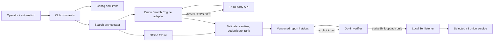

# Architecture

## Purpose and boundaries

`darkfootprint` is a local TypeScript CLI. It searches authorized indexes for a
keyword, normalizes references to checksum-valid v3 onion services, and renders
investigative leads. Direct onion access is a separate, explicit workflow routed
through a local Tor SOCKS listener.

There is no server, browser engine, account system, telemetry service, database,
background monitor, or bundled Tor process. Search/report output defaults to
stdout. File creation occurs when the operator selects `--out` or runs `init`,
which creates a non-secret configuration at the selected or default path.

The arrows to the third-party API and to Tor are separate trust boundaries. The
Tor proxy setting does not route indexed API searches.

## Components

| Component                   | Responsibility                                                                                                                                                  | Source                                                                                       |
| --------------------------- | --------------------------------------------------------------------------------------------------------------------------------------------------------------- | -------------------------------------------------------------------------------------------- |
| CLI                         | Defines commands, options, acknowledgement gates, output selection, and exit codes.                                                                             | `src/cli.ts:153-591`                                                                         |
| Configuration               | Loads a strict non-secret JSON shape, environment values, defaults, and loopback `socks5h` proxy validation.                                                    | `src/config.ts:7-30`, `src/config.ts:56-66`, `src/config.ts:68-138`, `src/config.ts:150-200` |
| Provider registry           | Exposes the API and fixture adapters and a manual-only Ahmia descriptor.                                                                                        | `src/providers/registry.ts:6-30`                                                             |
| Onion Search Engine adapter | Builds provider queries, requires an environment API key, validates the response shape, and maps hits.                                                          | `src/providers/onion-search-engine.ts:12-136`                                                |
| Fixture adapter             | Produces two deterministic synthetic results without network access.                                                                                            | `src/providers/fixture.ts:17-46`, `src/onion.ts:66-73`                                       |
| Search orchestrator         | Normalizes the query, enforces search bounds, calls selected providers, validates onion URLs, merges duplicates, and orders results.                            | `src/search.ts:40-62`, `src/search.ts:80-129`, `src/search.ts:131-374`                       |
| Provider HTTP transport     | Allows one compiled-in HTTPS origin, disables redirects, bounds the body, redacts the exact key from provider errors, and returns a small header allowlist.     | `src/http.ts:18-142`                                                                         |
| Onion URL model             | Validates the v3 checksum/version and restricts scheme, credentials, and ports before canonicalization.                                                         | `src/onion.ts:43-64`, `src/onion.ts:82-115`                                                  |
| Onion transport             | Performs bounded text `GET` requests through a SOCKS agent and confines redirects to the original onion host.                                                   | `src/http.ts:178-323`                                                                        |
| Verifier                    | Checks Tor availability, validates limits, verifies at most 20 results two at a time, extracts inert text, and records response metadata/hashes.                | `src/verify.ts:22-187`                                                                       |
| Rendering and reports       | Emits human, JSON, JSONL, or Markdown output; validates imported reports and reads/writes user-selected files.                                                  | `src/output.ts:27-108`, `src/report.ts:9-253`, `src/report.ts:255-285`                       |
| Sanitization                | Removes terminal and bidirectional controls, normalizes/bounds selected text, redacts exact secrets, escapes Markdown, and recursively cleans raw JSON strings. | `src/sanitize.ts:1-103`                                                                      |

## Execution flows

### Indexed search

1. The CLI loads defaults, a selected JSON configuration file, and environment
   secrets.
2. The query is normalized with NFKC, rejected if it contains terminal/bidi
   controls, and limited to 256 Unicode characters and 1 KiB.
3. With no `--source`, the orchestrator selects `onionsearchengine` only while
   its configuration flag is enabled; otherwise it fails with no source.
   Explicit sources are deduplicated and must be registered automated providers.
4. Provider pages run within configured page, result, and timeout limits. The
   API key is passed only to the API adapter.
5. Every returned URL must canonicalize as a checksum-valid v3 onion URL.
   Invalid hits become warnings rather than targets.
6. Results are merged by canonical URL, provenance is retained, and ordering is
   relevance descending then canonical URL.
7. The report is rendered to stdout or exclusively created at `--out`; `--force`
   opts into replacement.

The API transport uses direct Node `fetch`. Reports record `index_route` as
`offline`, `direct`, or `mixed` according to the selected providers.
It accepts only `https://onionsearchengine.com`, sends `GET`, rejects redirects,
requests identity encoding, and caps each response at 2 MiB
(`src/http.ts:48-142`). The advanced `request get` path emits the provider-shaped
payload and selected headers after recursively stripping terminal/bidirectional
controls and redacting exact API-key occurrences; unlike a normal search, it
does not map the data into normalized results
(`src/cli.ts:510-572`, `src/sanitize.ts:82-103`).

### Optional onion verification

Verification starts either after `search --verify-onion` or from a previously
saved JSON report with `onion verify --input`. Both command paths require
`--acknowledge-risk` (`src/cli.ts:337-438`).

Before network access, the proxy must parse as credential-free `socks5h` on
`127.0.0.1`, `localhost`, or `::1`; a TCP probe must succeed
(`src/config.ts:150-200`, `src/verify.ts:124-153`). This proves only that a local
listener is present, not that it is a correctly configured Tor process.

The transport revalidates the target and every redirect. It accepts only HTTP
or HTTPS v3 onion URLs on ports 80/443, follows at most two same-host redirects,
accepts text/HTML response types, and caps each response at 512 KiB
(`src/onion.ts:82-115`, `src/http.ts:254-323`). Results are processed two at a
time and only the first bounded subset is selected (`src/verify.ts:124-170`).

HTML is parsed as data, with `script`, `style`, `noscript`, `svg`, `iframe`,
`object`, `embed`, and `form` elements removed. The verifier records sanitized
title/text-derived evidence,
hashes, HTTP metadata, and keyword presence; it does not render a browser or
load subresources (`src/verify.ts:22-98`).

## Configuration and precedence

The built-in configuration defaults to 25 results, one provider page, a
15-second per-request timeout, five verifications, and
`socks5h://127.0.0.1:9050` (`src/config.ts:56-66`).

Configuration file selection is:

1. `--config <path>`;
2. `DARKFOOTPRINT_CONFIG`;
3. `.darkfootprint/config.json` below the user's home directory.

For the Tor proxy, a verification command's `--proxy` wins over
`DARKFOOTPRINT_TOR_PROXY`, then the JSON `tor.proxy`, then the built-in default
(`src/config.ts:78-104`, `src/cli.ts:381-385`, `src/cli.ts:425-429`).

The provider API key is accepted only from
`DARKFOOTPRINT_ONIONSEARCHENGINE_API_KEY` and is not part of the configuration
schema (`src/config.ts:7-30`, `src/config.ts:128-137`). The
`providers.onionsearchengine.enabled` field controls whether the API is selected
implicitly when `search` has no `--source`. An explicit source selection still
overrides it, while `sources check` and `request get` do not consult it. The
field is a default-selection preference, not an authorization or network-deny
control (`src/config.ts:56-59`, `src/search.ts:170-196`,
`src/cli.ts:307-335`, `src/cli.ts:507-568`).

## Data model and output

Search reports use schema version `1.0` and contain:

- run identifier, normalized query, timestamps, selected sources, effective
  limits, and the index-route classification;
- source status and errors;
- canonical results with stable IDs, snippets, relevance, provenance, and a
  verification state;
- an explicit warning that indexed data is unverified, plus a query-disclosure
  warning whenever an API provider is selected.

The TypeScript contract is in `src/types.ts:1-129`. JSONL output consists of a
`run` record, source-status records, result records, and `run_end`
(`src/output.ts:27-51`). Markdown renders onion URLs as code spans rather than
clickable links (`src/output.ts:52-82`).

Imported reports must be regular files no larger than 5 MiB. Strict schemas cap
the main arrays and reject unknown fields; known rendered strings are required
to be canonical, control-free, and bounded. Each result URL, including a saved
final verification URL, is canonicalized again and checked for consistency
before use (`src/report.ts:9-253`). Reports are still unsigned investigative
data: validation cannot establish provenance or the truth of an indexed claim.

## Extension rules

New providers belong behind the `SearchProvider` interface
(`src/providers/provider.ts:1-13`) and registry. A production adapter should
retain a fixed destination, read-only operation, runtime response schema,
timeouts and byte/page limits, text sanitation, provenance, and a deterministic
offline test double. A provider cannot be made automated solely by adding a
descriptor.

Changes that add storage, new destinations, authentication, crawling, browser
execution, downloads, telemetry, background work, or a remote proxy materially
change the trust model and require explicit design, documentation, and security
review. See [THREAT_MODEL.md](../THREAT_MODEL.md).
